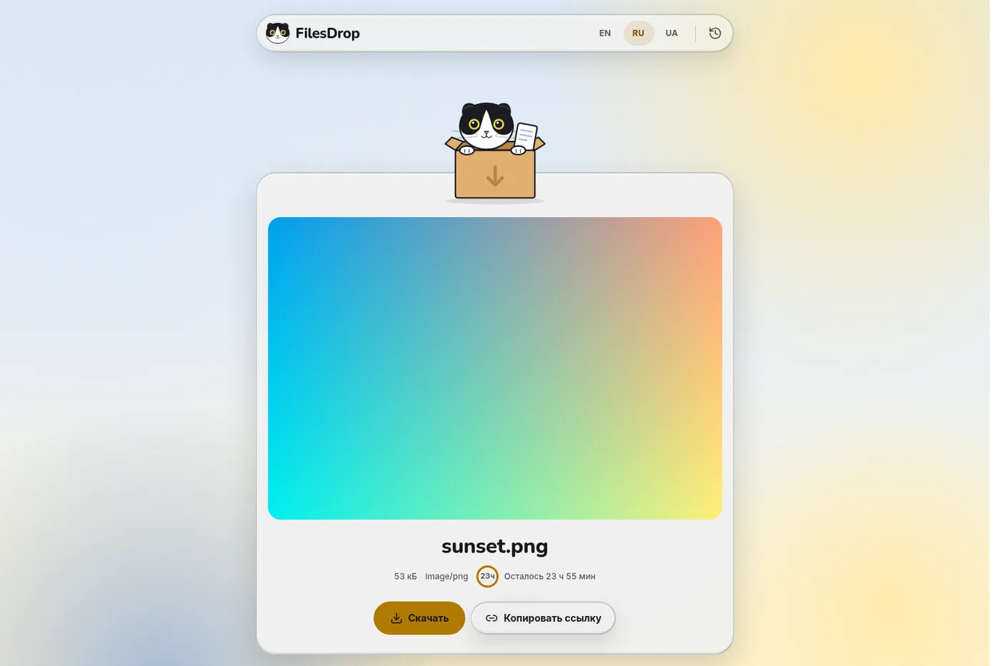
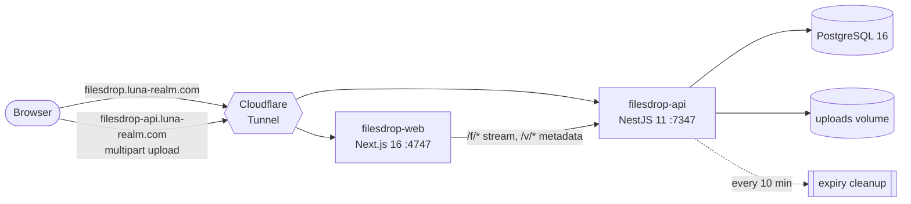

<div align="center">


# FilesDrop

**Drop a file, get a link.** No account, no fuss. The link lives for up to a day, then the cat knocks it off the table.

[**filesdrop.luna-realm.com**](https://filesdrop.luna-realm.com)


</div>

---

FilesDrop is an anonymous, catbox-style file host. Drop a file, paste a screenshot or give it a URL, and you get a link right away, ready to send. Files live **1, 12 or 24 hours** and are then deleted. Your upload history lives in your own browser, along with a secret token that lets you delete a file early. Nobody else can.

It is built on [glass-ui](https://github.com/AndreyBegma/glass-ui), a liquid-glass design system, and fronted by a black-and-white Scottish Fold. The cat reacts to everything you do.

## Features

- **Four ways in.** Drag & drop, the file picker, <kbd>Ctrl</kbd>+<kbd>V</kbd> anywhere on the page, or paste a link and the server fetches it.
- **Several files at once.** Each file uploads with its own progress ring and gets its own link.
- **Two kinds of link.** The direct link `/f/<slug>.<ext>` embeds in Telegram, Discord and Markdown. The preview link `/v/<slug>` opens a page with the file, a download button and Open Graph tags. A **Direct | Preview** switch picks which one gets copied, and remembers your choice.
- **Pick the lifetime:** 1 h, 12 h or 24 h. A countdown ring shows how much time is left.
- **History without accounts.** Your uploads are listed in `localStorage` with thumbnails, countdowns and a delete button. Expired entries fade out, and entries are tidied away a day after they expire.
- **Three languages, each with its own puns:** English, Русский, Українська. The language is picked from the browser and kept in a cookie. Shared links open in the *recipient's* language.
- **Light and dark** themes follow the system: a pastel sky by day, a starry night with glowing cat eyes by night.
- **Accessible and calm.** Every control is reachable by keyboard and is at least 44 px, progress is announced to screen readers, axe reports zero violations, and `prefers-reduced-motion` stops every animation.

<div align="center">





</div>

## Meet the cat

The mascot is hand-drawn vector art ([`docs/mascot/`](docs/mascot)), rebuilt in React from shared parts: head, ears, eyes, pupils, tail, paws. Each part moves on its own. The cat breathes, blinks, twitches an ear, follows your pointer with its eyes and tilts its head toward it.

| | | | | |
|:-:|:-:|:-:|:-:|:-:|
| <br/>idle | <br/>hover | <br/>drag over | <br/>upload | <br/>loading |
| <br/>success | <br/>link copied | <br/>too big | <br/>error | <br/>expired |
| <br/>empty | <br/>delete | <br/>offline | <br/>preview | <br/>favicon |

## How it works



- **The browser uploads straight to the API**, so a file never passes through Next.js on the way in. Next.js serves the pages and streams `/f/*` downloads back from the API without buffering, so the pretty links stay on the main domain.
- **A file's lifecycle:**
  1. The bytes are written to `.tmp/`, then renamed into place.
  2. A row records the slug, type, size, the hash of the delete token and `expiresAt`.
  3. A cron job deletes expired rows and files every 10 minutes, and on boot it sweeps files that have no row.
  4. An expired link answers **410 Gone** and shows the not-found cat.
- **Everything runs on one host** in one docker network: `cloudflared`, web, api and postgres. No port is published. The tunnel is the only way in, and TLS ends at Cloudflare.

## Security

Anonymous public file hosting attracts abuse, so the API is defensive by default:

| Threat | Mitigation |
|---|---|
| Malware hosting | Executables are refused by extension **and** by magic bytes (`MZ`, `ELF`) |
| HTML/SVG phishing and XSS from our origin | Only images (not SVG), video, audio, PDF and plain text are served inline. Everything else is an attachment. Every response carries `X-Content-Type-Options: nosniff` and `Content-Security-Policy: sandbox` |
| Lying extensions | The content is sniffed. A file whose bytes don't match its claimed type is served as `application/octet-stream` |
| SSRF through "upload from URL" | http(s) on ports 80/443 only, no credentials in the URL. **Every** resolved address must be public unicast: loopback, private, link-local, CGNAT, ULA, multicast and IPv4-mapped forms are refused. The connection is pinned to the checked IP, so DNS rebinding can't swap it. At most 3 redirects, each re-validated. 30 s timeout, aborted at 95 MB |
| Flooding | 30 uploads per 10 min per client IP, 95 MB per file (under Cloudflare's 100 MB body cap), 10 GB total quota (`507` when full) |
| Deleting other people's files | The delete token is 32 random bytes. Only its SHA-256 is stored, and it is compared in constant time |

## API

Base URL: `https://filesdrop-api.luna-realm.com`. The contract types live in [`packages/shared`](packages/shared/src).

| Method & path | Body | Success | Errors |
|---|---|---|---|
| `POST /api/files` | multipart `file`, `ttl` = `1h` \| `12h` \| `24h` | `201` `UploadResult` | 400 · 413 · 415 · 429 · 507 |
| `POST /api/files/from-url` | `{ "url", "ttl" }` | `201` `UploadResult` | 400 (`reason`) · 408 · 413 · 415 · 422 · 429 · 507 |
| `GET /api/files/:slug` | — | `200` `FileMeta` | 404 · 410 |
| `DELETE /api/files/:slug` | header `X-Delete-Token` | `204` | 403 · 404 · 410 |
| `GET /f/:slug[.ext]` | — | raw bytes, supports `Range` and `HEAD` | 404 · 410 |
| `GET /health` | — | `200` | — |

```sh
curl -F file=@cat.png -F ttl=24h https://filesdrop-api.luna-realm.com/api/files
# → { "slug": "k3x9ab2Q", "ext": "png", "mime": "image/png", "inline": true,
#     "expiresAt": "…", "deleteToken": "…", … }
# share https://filesdrop.luna-realm.com/f/k3x9ab2Q.png
```

## Running locally

Requirements: [Bun](https://bun.sh) 1.4+, Node.js 24+, Docker.

```sh
bun install
bun run db:setup     # PostgreSQL on 127.0.0.1:6543, migrations, seed
bun run start:dev    # api → http://localhost:7347 · web → http://localhost:4747
```

| Command | What it does |
|---|---|
| `bun run start:dev` | api and web in watch mode |
| `bun run build` | build everything (Turborepo, cached) |
| `bun run test` | Jest (api) and Bun test (web) |
| `bun run check` | Biome: lint, format, import order |
| `bun run db:migrate` · `db:studio` | create a migration · open Prisma Studio |
| `bun run db:down` | stop the dev database (its data is kept) |

### Configuration

Each app reads its own `.env` (git-ignored), documented in `.env.example`.

| Variable | App | Default (dev) | |
|---|---|---|---|
| `DATABASE_URL` | api | local Postgres on `:6543` | |
| `UPLOAD_DIR` | api | `./.uploads` | where the bytes live |
| `MAX_TOTAL_BYTES` | api | `10737418240` | total quota (10 GB) |
| `RATE_LIMIT` · `RATE_WINDOW_MS` | api | `30` · `600000` | uploads per window per IP |
| `TRUST_CF_HEADER` | api | `false` | use `CF-Connecting-IP` (only behind the tunnel) |
| `WEB_URL` | api | `http://localhost:4747` | CORS origin |
| `NEXT_PUBLIC_API_URL` | web | `http://localhost:7347` | where the browser uploads |
| `NEXT_PUBLIC_WEB_URL` | web | `http://localhost:4747` | used to build share links |
| `API_INTERNAL_URL` | web | `http://localhost:7347` | server-side fetches and `/f/*` streaming |

## Deployment

Merging into `main` deploys. [Woodpecker](.woodpecker/pipeline.yml):
1. runs the checks on every pull request;
2. on a push to `main`, builds the images;
3. syncs the stack into `/home/archi/stacks/filesdrop`;
4. runs `docker compose -p filesdrop up -d --wait`;
5. requires a `2xx` from both public hostnames before it calls the deploy done.

Secrets (`TUNNEL_TOKEN`, `POSTGRES_PASSWORD`) live only in that stack directory, never in git. The full runbook (first-time setup, rollback, status) is in [`deploy/README.md`](deploy/README.md).

## Project structure

```
apps/
  api/        NestJS 11 · Prisma 7 · files module, SSRF guard, cleanup cron
  web/        Next.js 16 · React 19 · Tailwind 4 · next-intl · motion
    src/components/
      cat/      the mascot: shared parts + 16 poses
      drop/     drop zone, URL field, result card
      history/  localStorage history panel
      shell/    header, footer and contacts, language switch, sky backdrop, toaster
packages/
  shared/     @filesdrop/shared: API contract types and constants
docker/       dev Postgres (filesdrop-dev) · production stack
deploy/       refresh, rollback and status scripts · runbook
docs/mascot/  the cat's source SVGs and parts map
```

## Privacy & rules

What FilesDrop stores, for how long, what stays in your browser, and the house rules (provided as is, no warranty, uploader responsibility): **[filesdrop.luna-realm.com/en/privacy](https://filesdrop.luna-realm.com/en/privacy)**. It is also available in [Russian](https://filesdrop.luna-realm.com/ru/privacy) and [Ukrainian](https://filesdrop.luna-realm.com/uk/privacy).

## Contact

| | |
|---|---|
| GitHub | [@AndreyBegma](https://github.com/AndreyBegma) |
| Email | [abegma137@gmail.com](mailto:abegma137@gmail.com) |
| Telegram | [@abegma](https://t.me/abegma) |

**Report an abusive file** (malware, phishing, illegal content, a rights violation): send the file's link by email or Telegram. Reported files are removed.

## Contributing

- Branch from **`develop`** and open pull requests into `develop`. `main` only receives releases from `develop`, and every merge to `main` goes to production.
- Bun only (exact versions), Biome only, TypeScript strict, no `any`. Prisma is imported only inside `apps/api`. See [`CLAUDE.md`](CLAUDE.md).
- glass-ui is consumed from npm as [`@andrewbehma/glass-ui`](https://www.npmjs.com/package/@andrewbehma/glass-ui). New UI building blocks belong there, not here.

<div align="center">
<br/>
<br/>
<sub>No sign-up. Files always land on their feet.</sub>
</div>
