<div align="center">

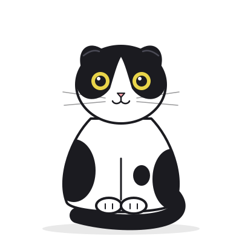

# FilesDrop

**Drop a file, get a link.** No account, no fuss. The link lives for up to three days, then the cat knocks it off the table.

[**filesdrop.luna-realm.com**](https://filesdrop.luna-realm.com)


[](https://discord.gg/mkQARkBs4C)

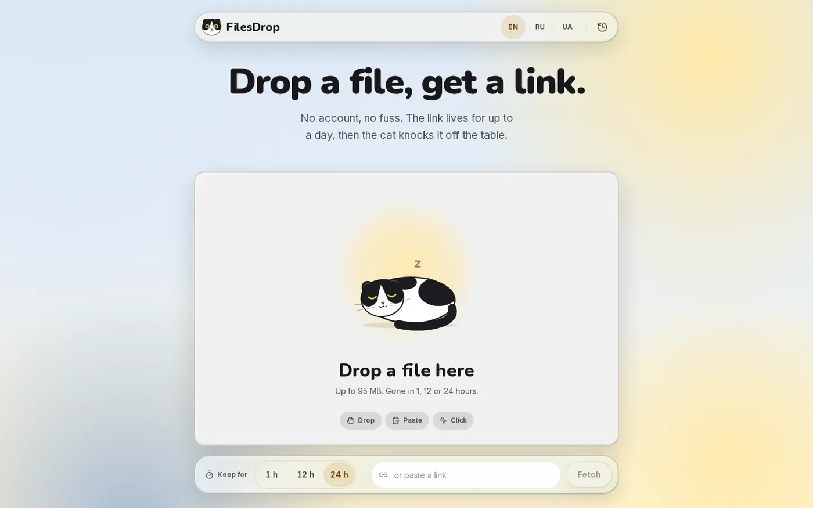
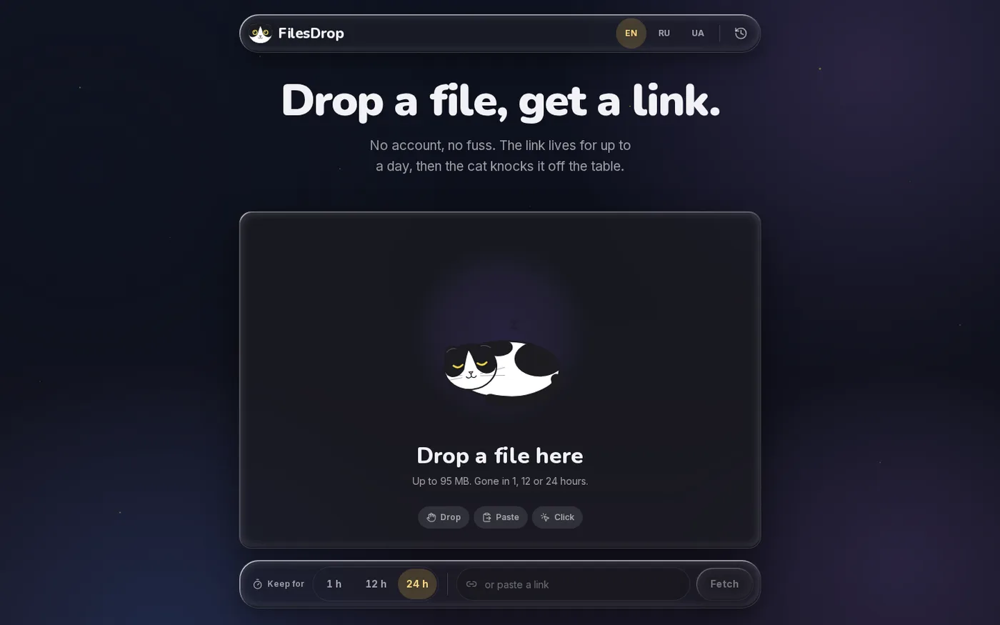

</div>

---

FilesDrop is an anonymous, catbox-style file host. Drop a file, paste a screenshot or give it a URL, and you get a link right away, ready to send. Files live **1, 12 or 24 hours, or 3 days** and are then deleted. The same cat also works in Telegram: [@catfilesdrop_bot](https://t.me/catfilesdrop_bot). Your upload history lives in your own browser, along with a secret token that lets you delete a file early. Nobody else can.

It is built on [glass-ui](https://github.com/AndreyBegma/glass-ui), a liquid-glass design system, and fronted by a black-and-white Scottish Fold. The cat reacts to everything you do.

## Features

- **Four ways in.** Drag & drop, the file picker, <kbd>Ctrl</kbd>+<kbd>V</kbd> anywhere on the page, or paste a link and the server fetches it.
- **Several files at once.** Each file uploads with its own progress ring and gets its own link.
- **Two kinds of link.** The direct link `/f/<slug>.<ext>` embeds in Telegram, Discord and Markdown. The preview link `/v/<slug>` opens a page with the file, a download button and Open Graph tags. A **Direct | Preview** switch picks which one gets copied, and remembers your choice.
- **Pick the lifetime:** 1 h, 12 h, 24 h or 3 days. A countdown ring shows how much time is left.
- **Password-protected files.** Lock an upload with a password (4 to 128 characters). The preview page hides the name, size and type until the password is entered, and `/f/` serves nothing without it. Only a salted scrypt hash is stored.
- **A Telegram bot.** Send a file to [@catfilesdrop_bot](https://t.me/catfilesdrop_bot) and get the same two links back, with buttons to change the lifetime or delete the file. See [Telegram bot](#telegram-bot).
- **History without accounts.** Your uploads are listed in `localStorage` with thumbnails, countdowns and a delete button. Expired entries fade out, and entries are tidied away a day after they expire.
- **Two languages, each with its own puns:** English and Українська. The language is picked from the browser (Ukrainian for Ukrainian, English for everything else) and kept in a cookie. Shared links open in the *recipient's* language. Old `/ru/…` links redirect to the same page in English.
- **Light and dark** themes follow the system by default: a pastel sky by day, a starry night with glowing cat eyes by night. A header button switches between System, Light and Dark; the choice is kept in a cookie and rendered on the server, so the page never flashes the wrong theme.
- **Accessible and calm.** Every control is reachable by keyboard and is at least 44 px, progress is announced to screen readers, axe reports zero violations, and `prefers-reduced-motion` stops every animation.

<div align="center">
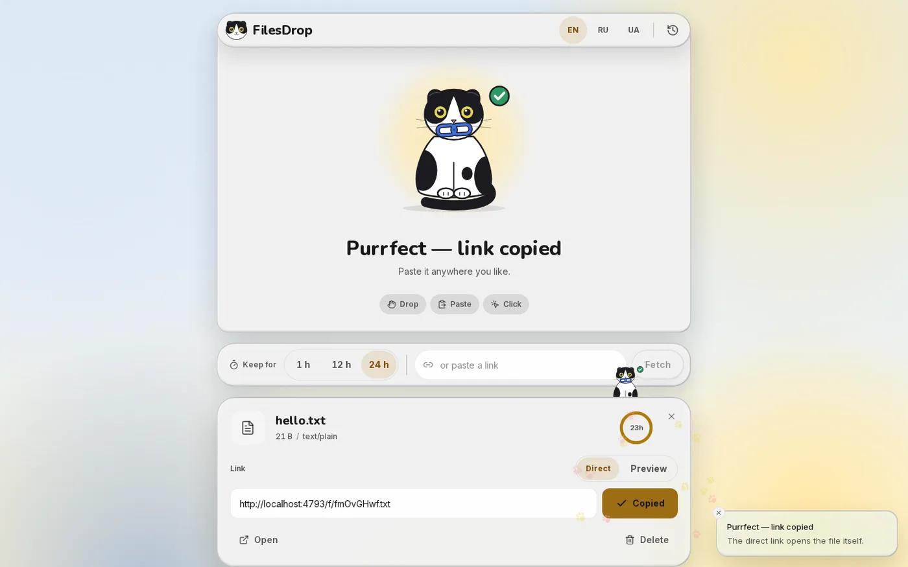
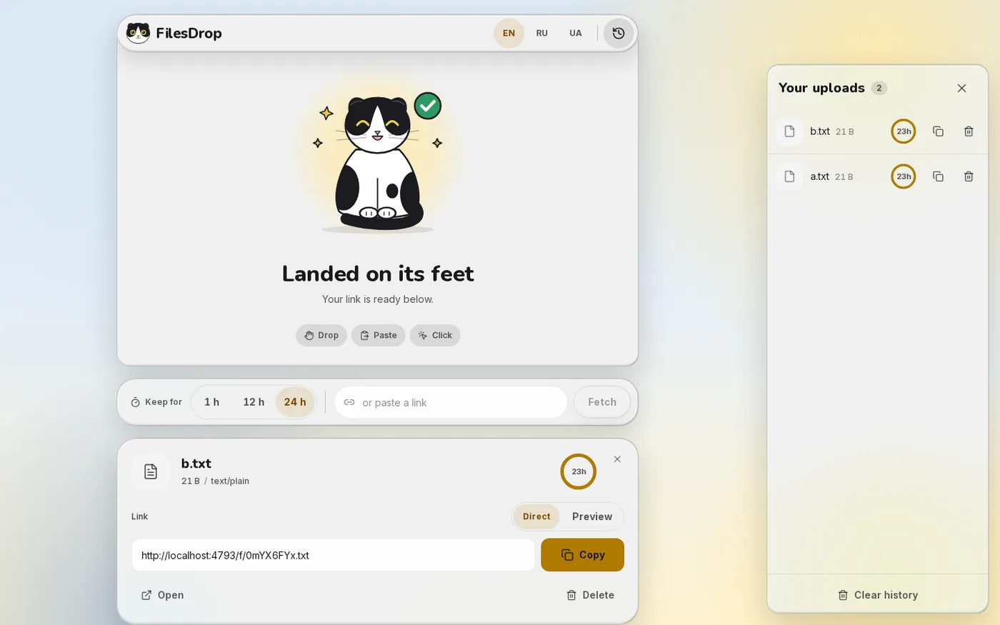
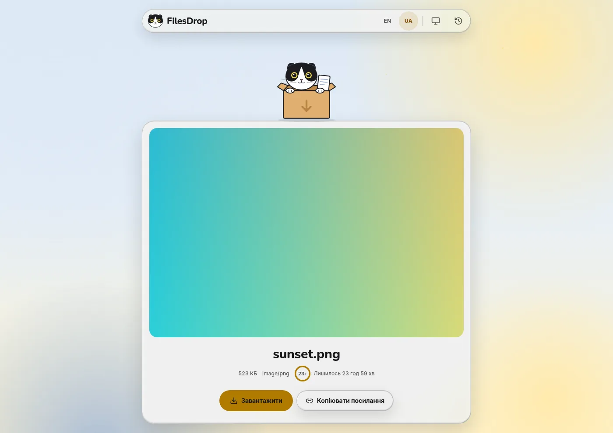
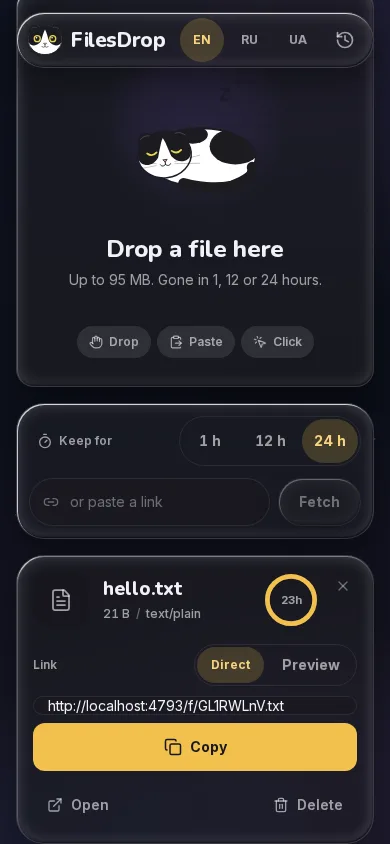
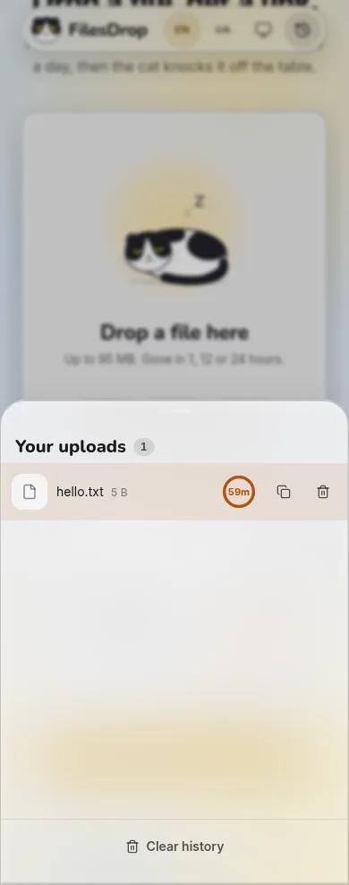
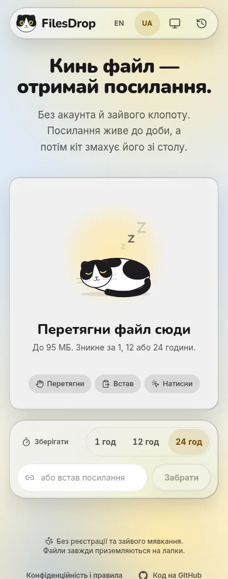
</div>

## Meet the cat

The mascot is hand-drawn vector art ([`docs/mascot/`](docs/mascot)), rebuilt in React from shared parts: head, ears, eyes, pupils, tail, paws. Each part moves on its own. The cat breathes, blinks, twitches an ear, follows your pointer with its eyes and tilts its head toward it.

| | | | | |
|:-:|:-:|:-:|:-:|:-:|
| 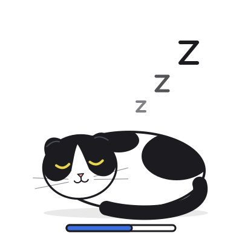<br/>idle | 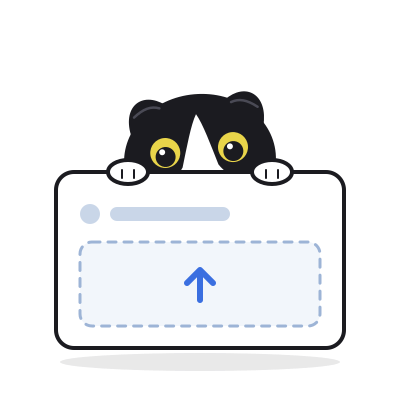<br/>hover | <br/>drag over | 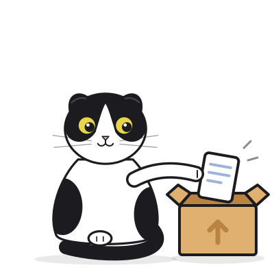<br/>upload | 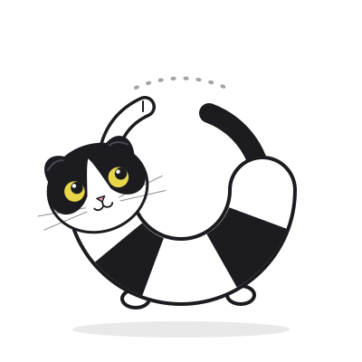<br/>loading |
| 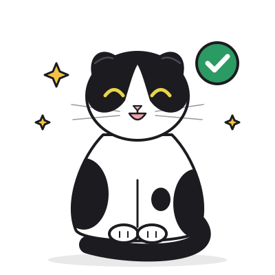<br/>success | 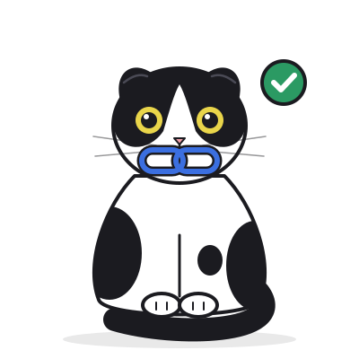<br/>link copied | 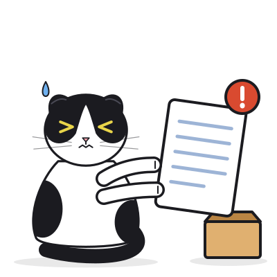<br/>too big | 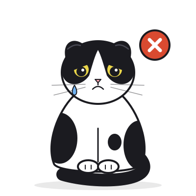<br/>error | 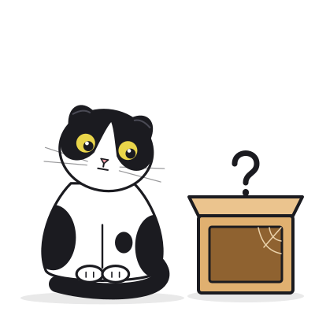<br/>expired |
| 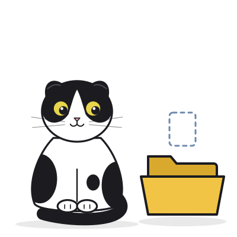<br/>empty | 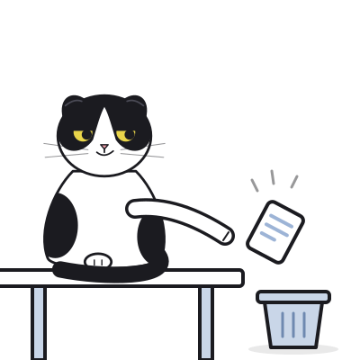<br/>delete | 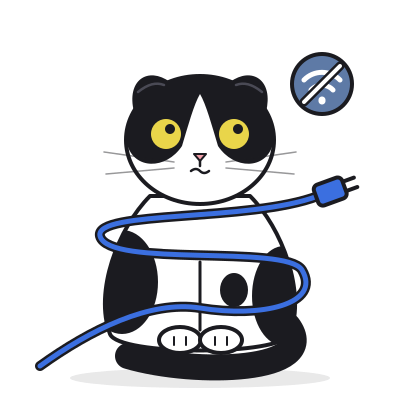<br/>offline | 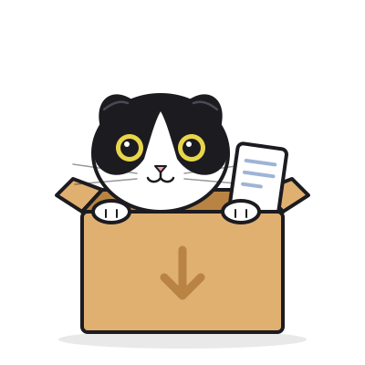<br/>preview | 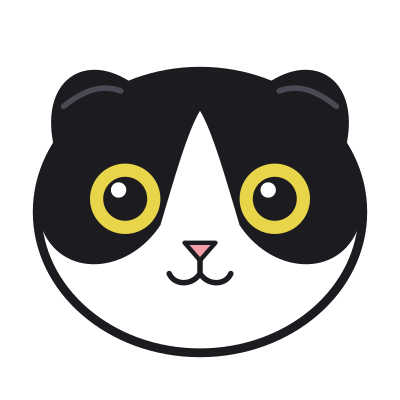<br/>favicon |

## How it works

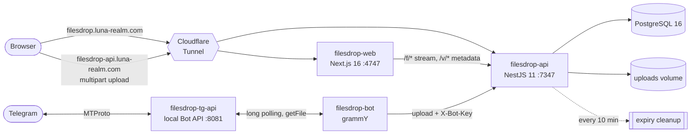

- **The browser uploads straight to the API**, so a file never passes through Next.js on the way in. Next.js serves the pages and streams `/f/*` downloads back from the API without buffering, so the pretty links stay on the main domain.
- **A file's lifecycle:**
  1. The bytes are written to `.tmp/`, then renamed into place.
  2. A row records the slug, type, size, the hash of the delete token and `expiresAt`.
  3. A cron job deletes expired rows and files every 10 minutes, and on boot it sweeps files that have no row.
  4. An expired link answers **410 Gone** and shows the not-found cat.
- **Everything runs on one host** in one docker network: `cloudflared`, web, api and postgres, plus the Telegram bot and its local Bot API server when they are enabled. No port is published. The tunnel is the only way in, and TLS ends at Cloudflare. The bot talks to Telegram outbound only, by long polling, so it needs no public address either.

## Telegram bot

[**@catfilesdrop_bot**](https://t.me/catfilesdrop_bot): send it a photo, video, document, audio, voice note, GIF or video circle, up to **95 MB**, and it replies with a direct link and a preview link. Buttons under the reply change the lifetime (1 h · 12 h · 24 h · 3 d) or delete the file; they keep working for 30 minutes. It speaks English and Ukrainian. It does not set passwords: lock a file on the website.

| Command | What it does |
|---|---|
| `/start` | asks for your language on the first visit, then says hello and explains how it works |
| `/help` | the same explanation: what to send, the limits, the buttons |
| `/lang` | pick English or Ukrainian; the choice is remembered |

**Limits:** up to 95 MB per file, one upload at a time per person, and the API's 30 uploads per 10 minutes, counted per Telegram user. Lifetimes are the same as on the site, and the buttons under a reply work for 30 minutes.

The bot remembers only your Telegram user id and the language you picked (`en` or `uk`), in one small JSON file, so it can answer in that language. Everything else it holds (which reply belongs to which file) lives in memory and is gone when the buttons expire. Details are on the [privacy page](https://filesdrop.luna-realm.com/en/privacy#bot).

The bot ([`apps/bot`](apps/bot), grammY) talks to its own **local Telegram Bot API server** (`filesdrop-tg-api`, `--local` mode) instead of `api.telegram.org`, which lifts the cloud API's 20 MB download cap and puts the downloaded file straight onto a shared volume. The bot uploads that file to `filesdrop-api` over the internal network with `X-Bot-Key` (a shared secret, `BOT_API_KEY`) and `X-Bot-User`, so the API counts the upload against that **Telegram user** (`tg:<id>`, the same 30 per 10 minutes) instead of the bot's single IP. There is no "change lifetime" endpoint: a lifetime button re-uploads the same bytes and deletes the old file. The local copy is deleted when the buttons expire, and a sweep every 15 minutes removes anything older than 2 hours.

## Security

Anonymous public file hosting attracts abuse, so the API is defensive by default:

| Threat | Mitigation |
|---|---|
| Malware hosting | Executables are refused by extension **and** by magic bytes (`MZ`, `ELF`) |
| HTML/SVG phishing and XSS from our origin | Only images (not SVG), video, audio, PDF and plain text are served inline. Everything else is an attachment. Every response carries `X-Content-Type-Options: nosniff` and `Content-Security-Policy: sandbox` |
| Lying extensions | The content is sniffed. A file whose bytes don't match its claimed type is served as `application/octet-stream` |
| SSRF through "upload from URL" | http(s) on ports 80/443 only, no credentials in the URL. **Every** resolved address must be public unicast: loopback, private, link-local, CGNAT, ULA, multicast and IPv4-mapped forms are refused. The connection is pinned to the checked IP, so DNS rebinding can't swap it. At most 3 redirects, each re-validated. 30 s timeout, aborted at 95 MB |
| Flooding | 30 uploads per 10 min per client IP (per Telegram user for the bot, proven with `X-Bot-Key`), 95 MB per file (under Cloudflare's 100 MB body cap), 10 GB total quota (`507` when full) |
| Guessing a file's password | Only a salted **scrypt** hash is stored and checked in constant time. Wrong tries are limited to 10 per 15 min per IP and file, and 50 per file overall (`429`). A right password returns a **signed, short-lived token** (HMAC-SHA256 over the slug, 10 minutes) that `/f/` accepts as `?k=` or `X-File-Access`; nothing about it is stored. A locked file's meta reveals only `{ slug, locked, expiresAt }` |
| Deleting other people's files | The delete token is 32 random bytes. Only its SHA-256 is stored, and it is compared in constant time |

## API

Base URL: `https://filesdrop-api.luna-realm.com`. The contract types live in [`packages/shared`](packages/shared/src).

| Method & path | Body | Success | Errors |
|---|---|---|---|
| `POST /api/files` | multipart `file`, `ttl` = `1h` \| `12h` \| `24h` \| `72h`, optional `password` | `201` `UploadResult` | 400 · 413 · 415 · 429 · 507 |
| `POST /api/files/from-url` | `{ "url", "ttl", "password"? }` | `201` `UploadResult` | 400 (`reason`) · 408 · 413 · 415 · 422 · 429 · 507 |
| `GET /api/files/:slug` | — | `200` `FileMeta` (with `locked`), or only `{ slug, locked: true, expiresAt }` for a locked file | 404 · 410 |
| `POST /api/files/:slug/unlock` | `{ "password" }` | `200` `FileMeta` + `token`, `expiresInSec` | 403 · 404 · 409 · 410 · 429 |
| `DELETE /api/files/:slug` | header `X-Delete-Token` | `204` | 403 · 404 · 410 |
| `GET /f/:slug[.ext]` | locked files: `?k=<token>` or header `X-File-Access` | raw bytes, supports `Range` and `HEAD` | 401 · 404 · 410 |
| `GET /health` | — | `200` | — |

```sh
curl -F file=@cat.png -F ttl=24h https://filesdrop-api.luna-realm.com/api/files
# → { "slug": "k3x9ab2Q", "ext": "png", "mime": "image/png", "inline": true,
#     "expiresAt": "…", "deleteToken": "…", … }
# share https://filesdrop.luna-realm.com/f/k3x9ab2Q.png
```

## Running locally

Requirements: [Bun](https://bun.sh) 1.4+, Node.js 24+, Docker.

```sh
bun install
bun run db:setup     # PostgreSQL on 127.0.0.1:6543, migrations, seed
bun run start:dev    # api → http://localhost:7347 · web → http://localhost:4747
```

| Command | What it does |
|---|---|
| `bun run start:dev` | api and web in watch mode |
| `bun run build` | build everything (Turborepo, cached) |
| `bun run test` | Jest (api) and Bun test (web) |
| `bun run check` | Biome: lint, format, import order |
| `bun run db:migrate` · `db:studio` | create a migration · open Prisma Studio |
| `bun run db:down` | stop the dev database (its data is kept) |

### Configuration

Each app reads its own `.env` (git-ignored), documented in `.env.example`.

| Variable | App | Default (dev) | |
|---|---|---|---|
| `DATABASE_URL` | api | local Postgres on `:6543` | |
| `UPLOAD_DIR` | api | `./.uploads` | where the bytes live |
| `MAX_TOTAL_BYTES` | api | `10737418240` | total quota (10 GB) |
| `RATE_LIMIT` · `RATE_WINDOW_MS` | api | `30` · `600000` | uploads per window per IP |
| `TRUST_CF_HEADER` | api | `false` | use `CF-Connecting-IP` (only behind the tunnel) |
| `BOT_API_KEY` | api | empty (off) | shared with the bot: per-Telegram-user rate limit |
| `FILE_ACCESS_SECRET` | api | random per boot | signs unlock tokens; required in production |
| `WEB_URL` | api | `http://localhost:4747` | CORS origin |
| `NEXT_PUBLIC_API_URL` | web | `http://localhost:7347` | where the browser uploads |
| `NEXT_PUBLIC_WEB_URL` | web | `http://localhost:4747` | used to build share links |
| `API_INTERNAL_URL` | web | `http://localhost:7347` | server-side fetches and `/f/*` streaming |

The bot (`apps/bot`) is part of the production stack, under the compose profile `bot`. Its secrets (`TELEGRAM_BOT_TOKEN`, `TELEGRAM_API_ID`, `TELEGRAM_API_HASH`, `BOT_API_KEY`) live in the stack directory; see [Telegram bot in `deploy/README.md`](deploy/README.md#telegram-bot).

## Deployment

Merging into `main` deploys. [Woodpecker](.woodpecker/pipeline.yml):
1. runs the checks on every pull request;
2. on a push to `main`, builds the images;
3. syncs the stack into `/home/archi/stacks/filesdrop`;
4. runs `docker compose -p filesdrop up -d --wait`;
5. requires a `2xx` from both public hostnames before it calls the deploy done.

Secrets (`TUNNEL_TOKEN`, `POSTGRES_PASSWORD`, `FILE_ACCESS_SECRET` and the bot's) live only in that stack directory, never in git. The full runbook (first-time setup, rollback, status) is in [`deploy/README.md`](deploy/README.md).

## Project structure

```
apps/
  api/        NestJS 11 · Prisma 7 · files module, SSRF guard, cleanup cron
  bot/        grammY · the Telegram bot @catfilesdrop_bot (en/uk)
  web/        Next.js 16 · React 19 · Tailwind 4 · next-intl · motion
    src/components/
      cat/      the mascot: shared parts + 16 poses
      drop/     drop zone, URL field, result card
      history/  localStorage history panel
      shell/    header, footer and contacts, language and theme switches, sky backdrop, toaster
packages/
  shared/     @filesdrop/shared: API contract types and constants
docker/       dev Postgres (filesdrop-dev) · production stack (with the bot profile)
deploy/       refresh, rollback and status scripts · runbook
docs/mascot/  the cat's source SVGs and parts map
```

## Privacy & rules

What FilesDrop stores, for how long, what stays in your browser, and the house rules (provided as is, no warranty, uploader responsibility): **[filesdrop.luna-realm.com/en/privacy](https://filesdrop.luna-realm.com/en/privacy)**. It is also available [in Ukrainian](https://filesdrop.luna-realm.com/uk/privacy).

## Contact

| | |
|---|---|
| GitHub | [@AndreyBegma](https://github.com/AndreyBegma) |
| Email | [abegma137@gmail.com](mailto:abegma137@gmail.com) |
| Telegram | [@abegma](https://t.me/abegma) |

**Report an abusive file** (malware, phishing, illegal content, a rights violation): send the file's link by email or Telegram. Reported files are removed.

## Contributing

- Branch from **`develop`** and open pull requests into `develop`. `main` only receives releases from `develop`, and every merge to `main` goes to production.
- Bun only (exact versions), Biome only, TypeScript strict, no `any`. Prisma is imported only inside `apps/api`. See [`CLAUDE.md`](CLAUDE.md).
- glass-ui is consumed from npm as [`@andrewbehma/glass-ui`](https://www.npmjs.com/package/@andrewbehma/glass-ui). New UI building blocks belong there, not here.

<div align="center">
<br/>
<br/>
<sub>No sign-up. Files always land on their feet.</sub>
</div>
